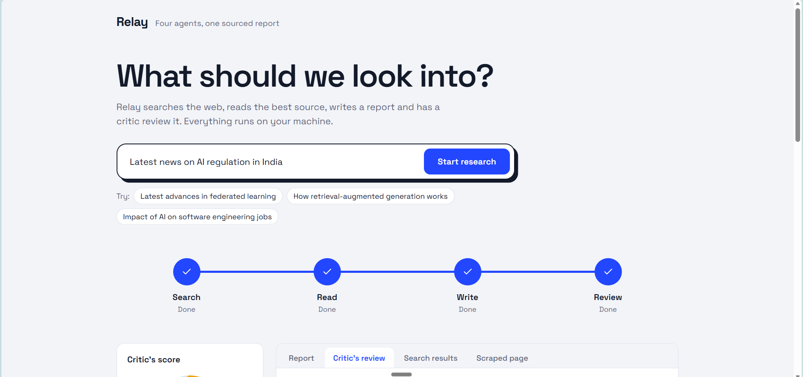
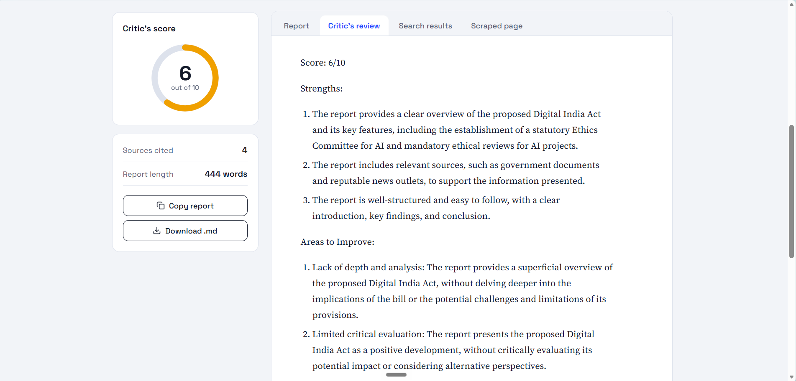
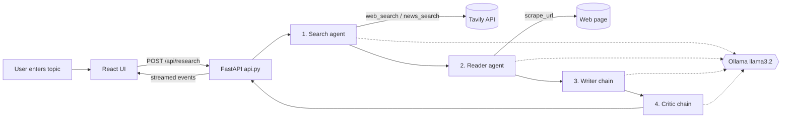

# Relay: Multi-Agent Research Assistant

Relay takes a topic and runs it through four steps. A search agent finds sources, a reader agent scrapes the best page, a writer drafts a structured report, and a critic scores it. A React interface shows each step as it finishes.

<!-- Add a screenshot or demo GIF here:  -->



## Features

- Four-stage pipeline: search, read, write, review
- Live progress in the UI: the backend streams each step to the browser
- Two search tools: general web search and a news search (last 7 days)
- Report with introduction, key findings, conclusion and sources
- Critic score out of 10 with strengths and areas to improve
- Copy or download the report as Markdown
- Local LLM through Ollama, so no model API key is needed
- Command-line version of the same pipeline

## Workflow



| Step | Component | Input | Output |
|------|-----------|-------|--------|
| 1 | Search agent | Topic | Titles, URLs, snippets (and dates for news) |
| 2 | Reader agent | Top of the search results | Text scraped from the most relevant URL (first 3000 characters) |
| 3 | Writer chain | Topic, search results and scraped text | Structured report |
| 4 | Critic chain | Report | `Score: X/10`, strengths, areas to improve, one-line verdict |

### How the UI and backend talk

`POST /api/research` with `{"topic": "..."}` returns a stream of server-sent events:

| Event | Payload | Meaning |
|-------|---------|---------|
| `step` | `{"type": "step", "step": 1..4}` | A new stage has started |
| `result` | `{"type": "result", "data": {...}}` | Final report, review, search results and scraped text |
| `error` | `{"type": "error", "message": "..."}` | Something failed; the UI shows the message |

`GET /api/health` returns `{"ok": true}` and is useful for checking that the backend is running.

## Tech stack

- **Frontend:** React (Vite), react-markdown, lucide-react
- **Backend:** FastAPI, Uvicorn
- **Agents:** LangChain, Ollama (`llama3.2`)
- **Tools:** Tavily search API, Requests, BeautifulSoup

## Project structure

```
.
├── agents.py          # search/reader agents, writer and critic chains
├── tools.py           # web_search, news_search (Tavily) and scrape_url
├── pipeline.py        # command-line version of the pipeline
├── api.py             # FastAPI backend for the React UI
├── requirements.txt
├── .env.example       # copy to .env and add your key
├── .gitignore
└── relay-ui/          # React frontend
    └── src/
        ├── App.jsx
        └── index.css
```

## Setup

### Prerequisites
- Python 3.10+ and Node.js 18+
- [Ollama](https://ollama.com) installed, with the model pulled: `ollama pull llama3.2`
- A [Tavily](https://tavily.com) API key

### 1. Backend
```bash
python -m venv .venv
source .venv/Scripts/activate      # Git Bash on Windows (macOS/Linux: source .venv/bin/activate)
pip install -r requirements.txt
cp .env.example .env               # then add your TAVILY_API_KEY to .env
python -m uvicorn api:app --reload --port 8000
```
Check http://localhost:8000/api/health. It should return `{"ok": true}`.

### 2. Frontend (second terminal)
```bash
cd relay-ui
npm install
npm run dev
```
Open http://localhost:5173. Keep Ollama running too.

### Command-line version
```bash
python pipeline.py
```

## Example topics

- `What is federated learning?`
- `Latest advances in federated learning`
- `Latest India news this week`
- `Latest AI and technology news this week`

Specific topics give better reports than broad ones. A small local model does better with a clear question.

## Configuration

| Variable | Where | Purpose |
|----------|-------|---------|
| `TAVILY_API_KEY` | `.env` | Tavily search access |
| `VITE_API_URL` | `relay-ui/.env` (optional) | Backend URL if it is not `http://localhost:8000/api/research` |

## Troubleshooting

| Problem | Likely cause | Fix |
|---------|--------------|-----|
| UI shows "Failed to fetch" | Backend is not running | Start uvicorn on port 8000 |
| `ModuleNotFoundError: No module named 'fastapi'` | Package installed outside the virtual environment | Activate `.venv`, then run `pip install -r requirements.txt` |
| `Connection aborted` / `RemoteDisconnected` | A network call to Tavily dropped (VPN, firewall, unstable connection) | Retry, turn off VPN, or try another network. Search calls retry up to 3 times |
| Connection refused on port 11434 | Ollama is not running | Start Ollama and check `ollama list` |
| Critic score shows "–" | Model did not use the `Score: X/10` format | Run again; this can happen with small models |

## Known limitations

- Report quality depends on the local model. `llama3.2` (3B) can miss details or drift from the requested format.
- The reader agent scrapes one page and truncates it to 3000 characters. Some sites block scraping.
- The agent chooses between `web_search` and `news_search` on its own, and a small model may pick the wrong one.
- The critic score is parsed from the model's text, so it is not a reliable measure of quality.
- Source URLs in the report come from the model's writing and should be checked before you rely on them.

## Possible next steps

- Scrape several sources instead of one
- Stream the report text token by token
- Save past reports and reopen them
- Deploy with a hosted model API (the app currently runs locally)

## Author

Nargis · [GitHub](https://github.com/Nargis7) · [LinkedIn](https://linkedin.com/in/nargis-p-511bab27b)